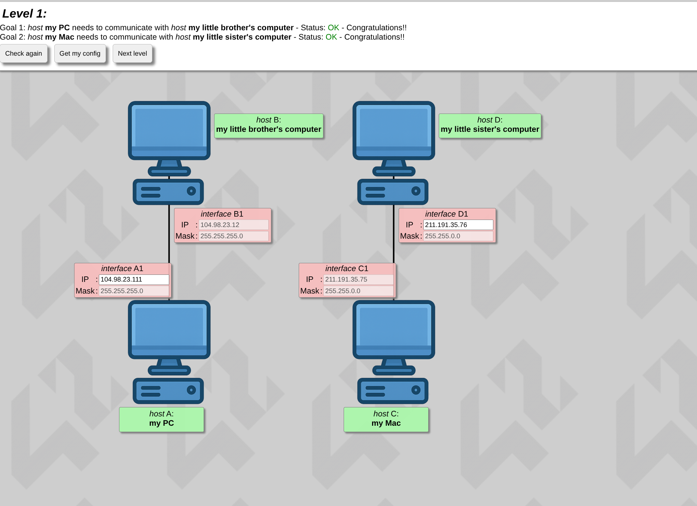
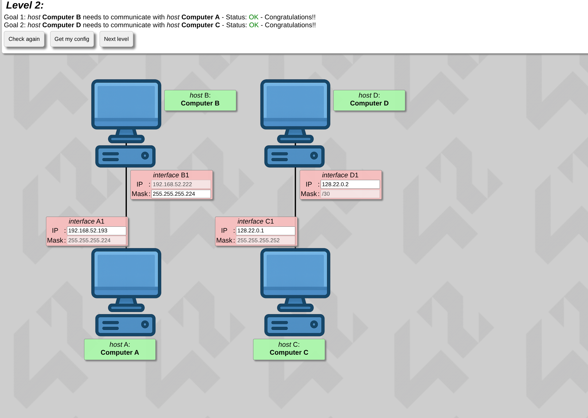
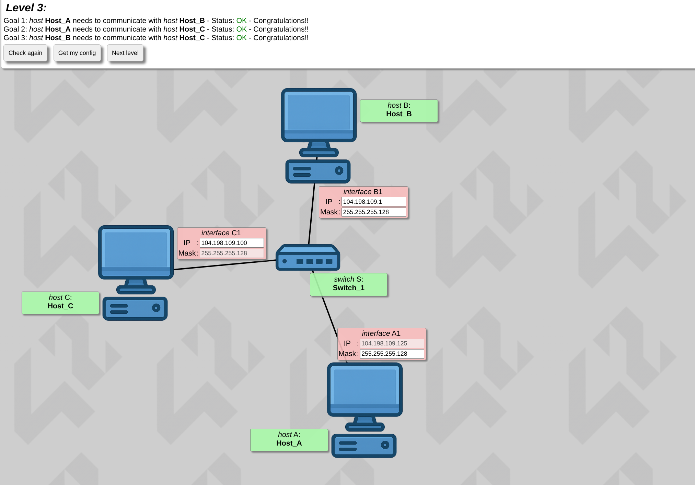
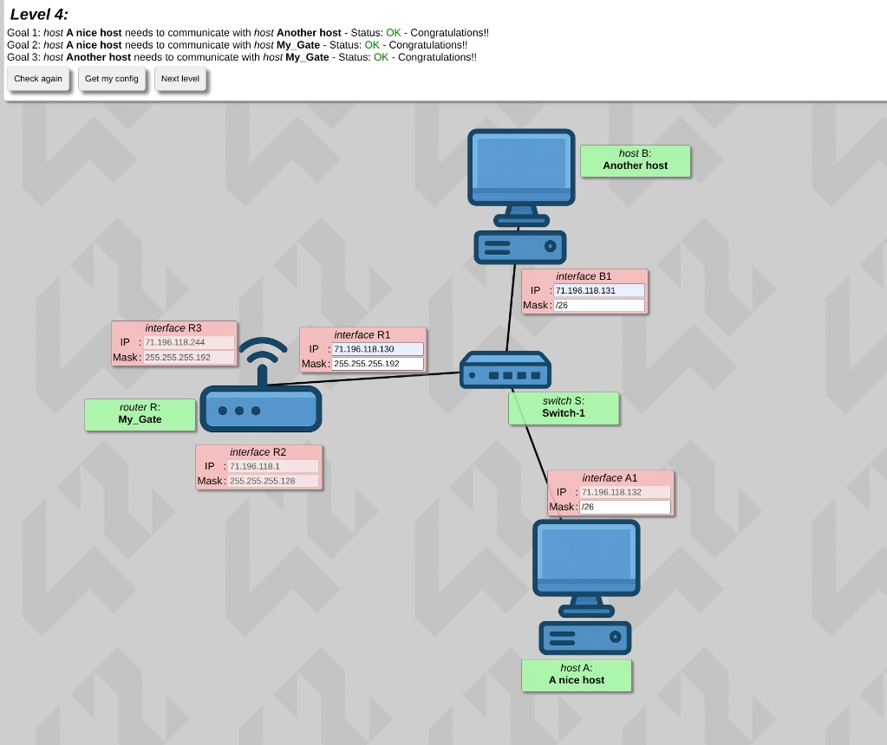
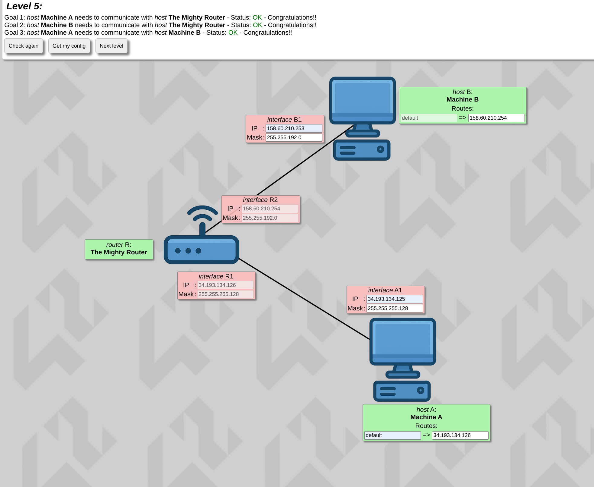
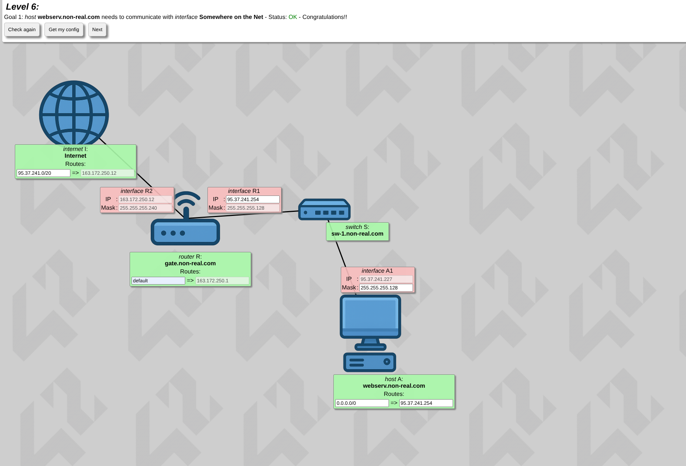
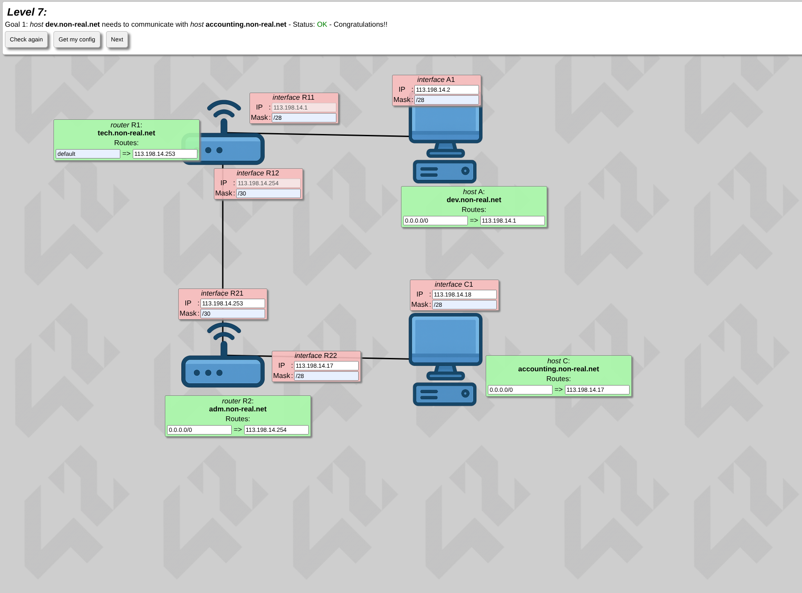
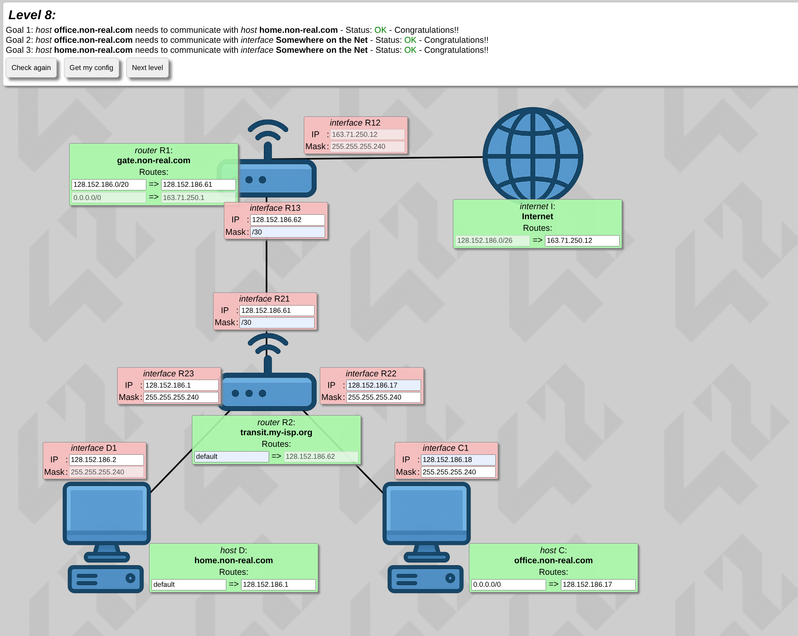
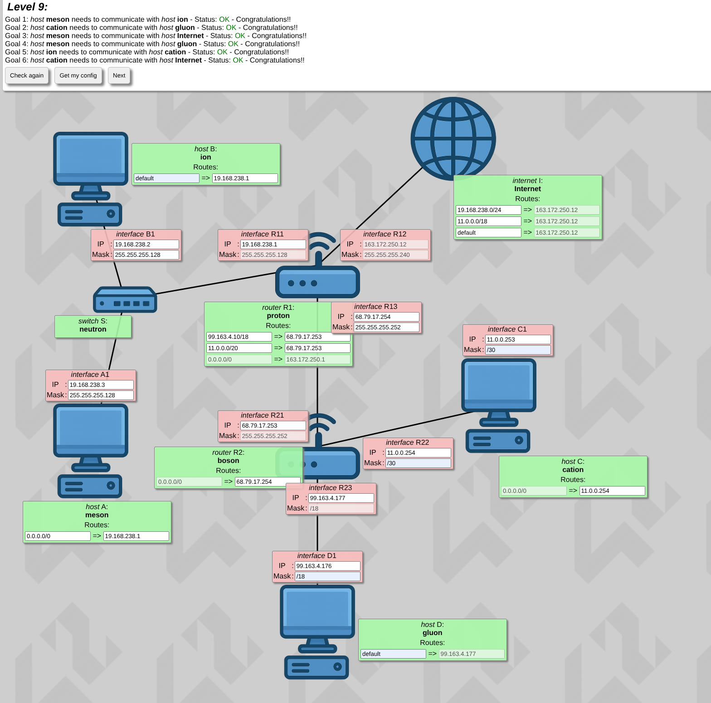
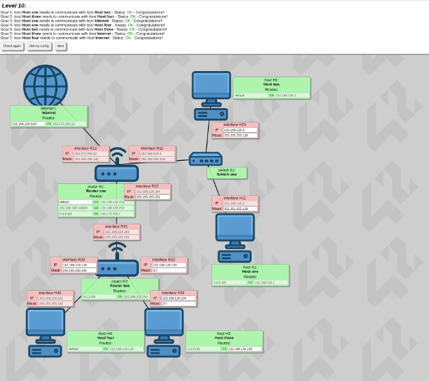

# 🌐 NetPractice — 42 Network Configuration Project

NetPractice is a networking project from the 42 curriculum designed to introduce the fundamentals of IPv4 networking through practical exercises. The project features simulated networks where devices must be configured correctly to achieve complete connectivity across 10 increasing levels of complexity.

---

## 💡 About the Project

The primary goal is to understand how IP addressing, subnetting, and routing work together in practice:
* **IPv4 Addressing & Subnetting**: Managing private IP ranges and CIDR notation.
* **Switches & Routers**: Connecting clients within the same subnet or across different subnets.
* **Routing Tables**: Configuring gateways and paths to ensure packets successfully reach their destination.

---

## 📸 Level Solutions & Visualizations

<b>🔹 Level 1 Solution</b>

 

<b>🔹 Level 2 Solution</b>

 

<b>🔹 Level 3 Solution</b>

 

<b>🔹 Level 4 Solution</b>

 

<b>🔹 Level 5 Solution</b>

 

<b>🔹 Level 6 Solution</b>

 

<b>🔹 Level 7 Solution</b>

 

<b>🔹 Level 8 Solution</b>

 

<b>🔹 Level 9 Solution</b>

 

<b>🔹 Level 10 Solution</b>

 

